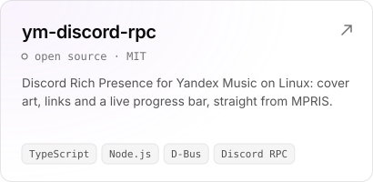
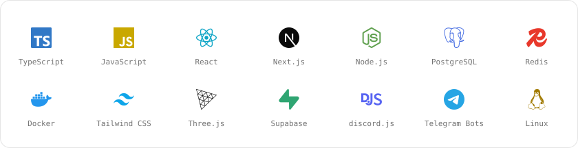

  <a href="https://eon1x.vercel.app"><picture>
    <source media="(prefers-color-scheme: dark)" srcset="assets/hero-dark.svg">
    
  </picture></a>

  Full-stack developer from Kazakhstan. I build products end to end — database, backend, bots and the frontend on top — and most of them have an AI agent somewhere inside.

<picture>
  <source media="(prefers-color-scheme: dark)" srcset="assets/label-projects-dark.svg">
  
</picture>

  <a href="https://myvisit.kz"><picture>
    <source media="(prefers-color-scheme: dark)" srcset="assets/card-visit-dark.svg">
    
  </picture></a>
  <a href="https://waymedia.ad"><picture>
    <source media="(prefers-color-scheme: dark)" srcset="assets/card-waymedia-dark.svg">
    
  </picture></a>
  <a href="https://www.vampiremedia.promo"><picture>
    <source media="(prefers-color-scheme: dark)" srcset="assets/card-vampire-dark.svg">
    
  </picture></a>
  <a href="https://github.com/Akio1965/ym-discord-rpc"><picture>
    <source media="(prefers-color-scheme: dark)" srcset="assets/card-ym-discord-rpc-dark.svg">
    
  </picture></a>

<picture>
  <source media="(prefers-color-scheme: dark)" srcset="assets/label-stack-dark.svg">
  
</picture>

<picture>
  <source media="(prefers-color-scheme: dark)" srcset="assets/stack-dark.svg">
  
</picture>

<picture>
  <source media="(prefers-color-scheme: dark)" srcset="assets/label-activity-dark.svg">
  
</picture>

<picture>
  <source media="(prefers-color-scheme: dark)" srcset="https://raw.githubusercontent.com/Akio1965/Akio1965/output/activity-dark.svg">
  
</picture>

<picture>
  <source media="(prefers-color-scheme: dark)" srcset="assets/label-contact-dark.svg">
  
</picture>

  <a href="https://eon1x.vercel.app"><picture>
    <source media="(prefers-color-scheme: dark)" srcset="assets/button-site-dark.svg">
    
  </picture></a>
  &nbsp;
  <a href="https://t.me/eon1x"><picture>
    <source media="(prefers-color-scheme: dark)" srcset="assets/button-telegram-dark.svg">
    
  </picture></a>

